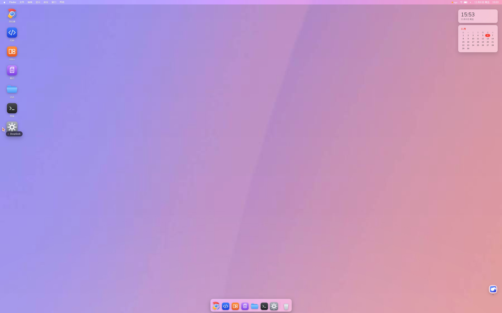
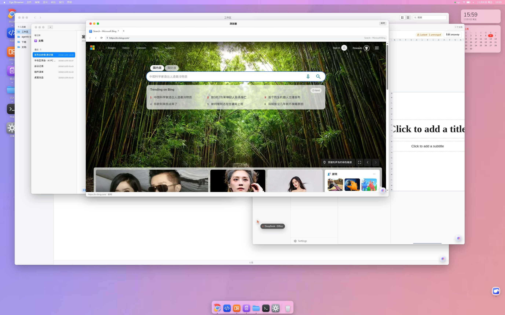
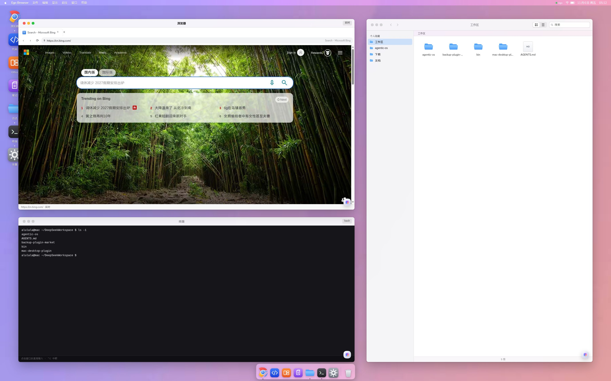

# Agent OS — a macOS desktop inside DeepSeek Harness

[中文说明](README.zh.md) · [Install](#install) · [Security](#security)

> **Most agent products give the model tools. This one gives it a desk.**
>
> DeepSeek Harness already mounts every plugin *into the session context*. So we stopped
> pretending the agent lives in a chat box and gave it the machine instead: a macOS
> desktop where all seven apps are real plugins, and you and the agent edit the same
> thing at the same time.

### Screenshots

**A desktop, with real software on it**



**Windows stack like a real machine — browser in front, notes and Office behind, Finder underneath**



**Not mock-ups: a live Bing page, a real `ls` in the terminal, your own workspace in Finder**



---

## Why this is an OS, not another tool call

MCP servers and "call this API" integrations share three structural limits:

| | API / MCP tool call | Plugin inside the DSH context |
|---|---|---|
| **Where state lives** | behind the tool; the model gets a summary | in the context; the model sees the same bytes you see |
| **Who else can touch it** | only the holder of the credential | you — in the real app, at the same time |
| **Can it see your work?** | no, your edits are invisible | yes — your edit *is* the next state it reads |
| **Parallelism** | one call at a time, serialized by the client | many windows, many tabs, many plugins at once |
| **Peripheral vision** | only what it called | what's open, what changed, what you're doing |

That gap is the product. The agent isn't calling out to software from a chat window —
**it sits in the same session, on the same files, in the same apps.** You type in a
cell, it reads that cell. It writes a note, you watch it appear. Nothing is exported
and re-imported, and nobody has to hand off control.

Plugins are mounted into the session rather than proxied behind an endpoint, so a
desktop is simply the most honest UI for what is already true.

---

## What you get

| App | What it really is |
|---|---|
| **Desktop** | Sonoma wallpaper, menu bar with a live clock, magnifying Dock, desktop icons, draggable & resizable windows with traffic lights |
| **Browser** (浏览器) | a real headless Chromium driven over CDP: parallel tabs, real mouse/keyboard, your existing logins |
| **Code** (代码) | the `dsh-code-workbench` Monaco panel, promoted to a window |
| **Office** | the editable Univer gateway (`127.0.0.1:9080`) — click a cell, change a cell |
| **Notes** (笔记) | your own Obsidian vault (`~/Documents`), rendered and editable |
| **Finder** (访达) | your workspace: grid/list views, breadcrumbs, text preview |
| **Terminal** (终端) | a persistent bash session with a blinking cursor |
| **Settings** (设置) | wallpaper, light/dark, Dock order, browser start page, "About This Mac" |
| **Desktop assistant** | a floating orb at the bottom-right opens the **native DSH conversation** as a floating panel (`⌘J`, `Esc` to close) |
| **Launchpad** (`F4`) | every installed app in one blurred grid, with search |
| **Spotlight** (`⌘Space`) | search apps *and* workspace files; `Enter` opens |
| **Control Centre** | menu-bar `◐`: Wi-Fi / Bluetooth / Do Not Disturb tiles, brightness (really dims the desktop) and volume |
| **Desktop widgets** | Sonoma-style clock and month calendar, top right |
| **Mission Control** (`F3`) | shrink all windows into a grid, press again to restore |

Every window carries a floating **assistant orb**: leave it closed and the app behaves
like normal software; open it and you ask a question about *that app's* state.

---

## Technical notes — what we hid, and what we turned into what

The desktop is one `shell.overlay` plugin plus one host service. It does not fork the
Harness and does not ship Electron. Everything below is a deliberate substitution.

### 1. The conversation is hidden on purpose

A chat transcript is the one thing a desktop must *not* show — it breaks the illusion
and eats the largest surface on screen. In desktop mode:

- the conversation column and the workspace sidebar are **parked** (still mounted, moved
  out of view — `display:none` breaks plugin lifecycles),
- input goes through window orbs and the menu bar instead of a transcript,
- the native right panel is parked, and un-parked only when a window explicitly owns it.

### 2. Each plugin became a desktop application

| Plugin | Before | In the desktop |
|---|---|---|
| `dsh-ego-browser` | a right-sidebar live panel mirroring whatever tab ego had focused | **Browser**: we stopped mirroring. The host reads the browser's CDP port from `browser.json` and captures a *specific target*, so the window shows its own tab while the agent drives others in parallel. ego's tab strip and toolbars are suppressed inside the window. |
| `dsh-univer-office` | read-only reviewer iframe (`View only`) | **Office**: the host asks `/univer-api/state` for the **gateway** URL (`:9080`) instead of the viewer, so the window *is* the editable app. A sandbox without `allow-popups` stops it spawning a stray window. |
| `dsh-code-workbench` | right-bar tab | **Code**: the same panel component hosted in a floating window, native tab strip hidden. |
| `dsh-obsidian-notes` | `shell.overlay` panels floating over the chat | **Notes**: we read the vault path from `~/.dsh/dsh-obsidian-vault.json` and render the Markdown ourselves (headings, tables, task lists, `#tags`) — plain files both sides edit. |
| — | — | **Finder / Terminal / Settings** are written for this desktop: the host exposes `/api/macos-desktop/{files,read,write}` and a persistent `/api/macos-terminal/session`. |

### 3. Why the browser window is not an iframe

Two measured facts on this platform:

- A same-origin iframe pointing at the SPA entry **never commits** (`about:blank`,
  `contentDocument` stays empty); only cross-origin frames navigate. "One iframe per
  app" cannot work.
- ego captures the **visible viewport** of one browser. Mirroring its own panel inside
  the page made the desktop film itself — windows inside windows, forever.

The fix is structural: the browser window is a **CDP client** of a *separate* Chromium
(`Page.captureScreenshot` + `Input.dispatchMouseEvent`), not a mirror of the shell's page.
Frames arrive at the window's exact content size (`Emulation.setDeviceMetricsOverride`
keeps page pixels == window pixels), so nothing is letterboxed or cropped.

### 4. The agent's control surface

No screen-scraping. The agent gets first-class handles:

```js
// in-page, from any tool or eval
window.__macos.state()                        // windows, focus
window.__macos.open('office')                 // open an app
window.__macos.rect('notes', {x, y, w, h})    // place it exactly
window.__macos.layout('stack')                // three-layer demo stage
```

```bash
# a CLI the agent can call as a tool
macos-browser tabs                  # what the human has open
macos-browser new "https://cn.bing.com/search?q=..."
macos-browser read 0 1 2            # innerText of three tabs at once
macos-browser click 1 420 380       # real mouse inside a tab
```

Host routes (all require the `dsh-auth` cookie):
`/api/macos-desktop/{window,files,read,write,univer,system,apps,assist}`,
`/api/macos-terminal/session`.

### 5. Deliberate limits

- **Parallelism is per-window, not per-panel.** Panel-type plugins (Code, Office) share a
  single right-bar instance, so one window hosts them at a time; everything else opens
  in parallel.
- **Not real-time.** Neither side pushes. The agent sees your edit the next time it reads
  (verified: type in a cell → `univer_inspect` reads your value back).
- **Single-user, local.** The desktop is a browser session against your own Harness.

---

## Install

```bash
dsh plugin add dsh-as-macos
```

Open the Web GUI and click the **桌面** capsule in the bottom-right corner, or run
`window.__macos.desktop(true)`.

Optional companions, each unlocking one app:

| App | Needs |
|---|---|
| Browser | `dsh-ego-browser` |
| Code | `dsh-code-workbench` |
| Office | `dsh-univer-office` |
| Notes | `dsh-obsidian-notes` |

A missing companion shows a "正在接入" placeholder instead of breaking the desktop.

## Security

The desktop is as powerful as a desktop. With a valid `dsh-auth` cookie these exist:

- `/api/macos-terminal/*` — **arbitrary shell commands**
- `/api/macos-desktop/{read,write}` — **read/write** your workspace and `~/Documents`
- `/api/macos-desktop/window` — spawn a headless Chromium and `eval` inside its pages
- `/api/macos-desktop/ego` — CDP against your logged-in browsing session

They are local-only and cookie-gated, but treat the plugin the way you'd treat a
terminal. Set `DSH_MACOS_BROWSER_PROXY` if your network needs a proxy; no proxy is
assumed otherwise.

## License

MIT © 2026 [Yue-Lyu123](https://github.com/Yue-Lyu123). See [LICENSE](LICENSE).
