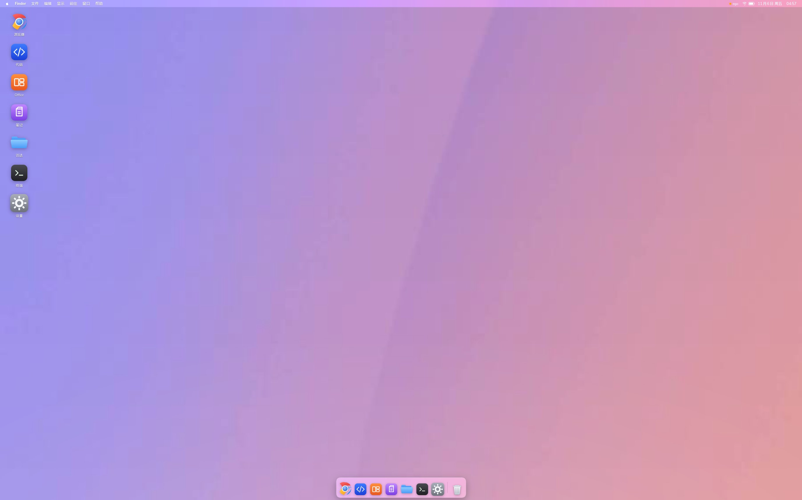
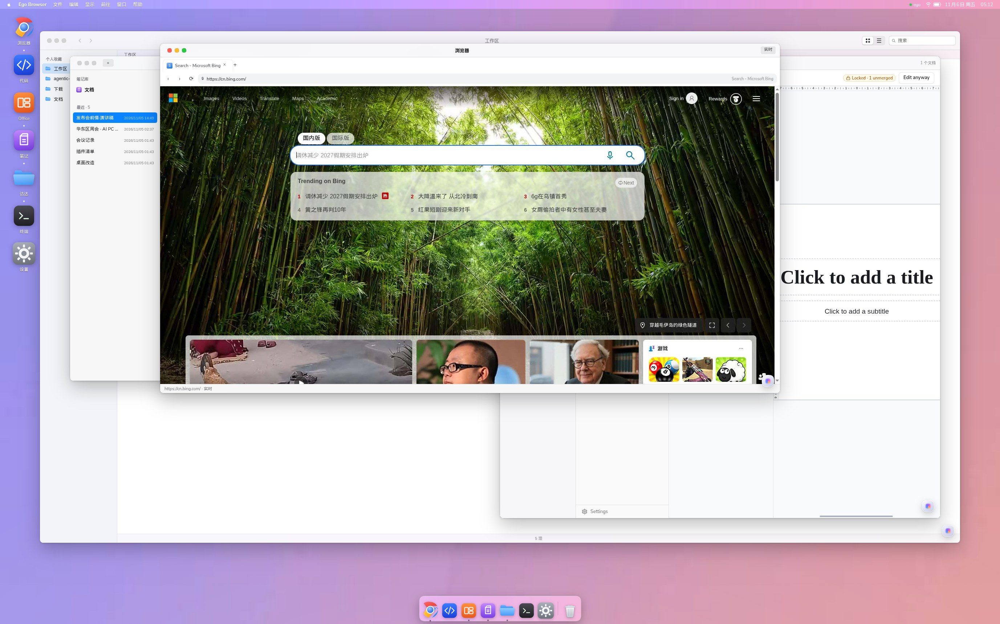
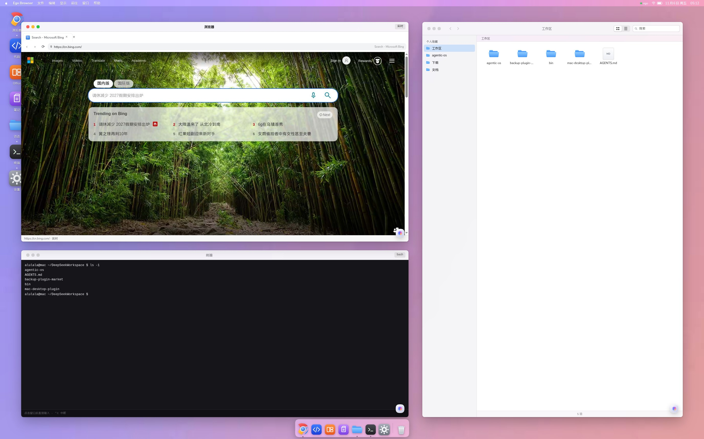

# Agent OS —— 装进 DeepSeek Harness 的一台 macOS 桌面

[English](README.md) · [安装](#安装) · [安全边界](#安全边界)

> **大多数 agent 产品给模型工具；我们给它一张桌子。**
>
> DeepSeek Harness 本来就把每个插件挂进会话上下文。既然如此，就不必再假装 agent 住在一个聊天框里——
> 干脆把它要操作的那台机器给它：一台 macOS 桌面，桌面上七个软件全是真插件，
> 你和 agent 同时改同一份东西。

### 截图

**一台桌面，上面放着真软件**



**窗口像真机器一样叠着：浏览器在最前，笔记与 Office 在后面，访达在底下**



**不是贴图：真的 Bing 页面、终端里真的 `ls`、访达里你自己的文件**



---

## 为什么这是一个操作系统，而不是又一个工具调用

MCP server 和“调这个接口”的集成，有三个结构性限制：

| | API / MCP 工具调用 | 插件在 DSH 上下文里 |
|---|---|---|
| **状态在哪** | 在工具背后，模型只拿到摘要 | 在上下文里，模型看到的就是你看到的那些字节 |
| **还有谁能改** | 只有持凭证的那个程序 | 你，在真软件里，同一时间 |
| **看得到你在改什么吗** | 看不到 | 看得到——你改完的就是它下一步读到的状态 |
| **并行** | 一次一个调用，由客户端串行 | 多窗口、多标签、多插件同时进行 |
| **视野** | 只知道它调用过的东西 | 知道开着什么、变了什么、你正在干什么 |

这个差距就是产品本身。agent 不是从聊天窗里向外调软件，**它和你坐在同一个会话里、同一批文件上、同一批软件里**。
你在格子里打字，它读到的就是这个格子；它写一篇笔记，你眼看着字出现。没有任何“导出 / 导入”，也不需要谁把控制权交给谁。

插件是挂进会话的，不是藏在某个端点后面代理出来的——所以“桌面”只是把一件本来就成立的事，用最诚实的方式画了出来。

---

## 你会得到什么

| 桌面软件 | 它背后到底是什么 |
|---|---|
| **桌面本身** | Sonoma 壁纸、带实时时钟的菜单栏、可放大的程序坞、桌面图标、带红黄绿灯的可拖动可缩放窗口 |
| **浏览器** | 一个真实的无头 Chromium，走 CDP 驱动：多标签并行、真实鼠标键盘、登录态照旧 |
| **代码** | `dsh-code-workbench` 的 Monaco 面板，被提升成一个窗口 |
| **Office** | 可编辑的 Univer 网关（`127.0.0.1:9080`）——点哪个格，改的就是哪个格 |
| **笔记** | 你自己的 Obsidian 库（`~/Documents`），直接渲染、直接编辑 |
| **访达** | 你的工作区：图标/列表视图、面包屑、文本预览 |
| **终端** | 一个常驻的 bash 会话，带闪烁光标 |
| **设置** | 壁纸、深浅色、程序坞顺序、浏览器起始页、「关于本机」 |

每个窗口右下角都有一颗悬浮的**精灵球**：关着的时候它就是一个普通软件；点开可以针对**这个软件当前的状态**提问。

---

## 技术说明 —— 我们藏了什么，又把什么变成了什么

整个桌面 = 一个 `shell.overlay` 插件 + 一个宿主服务。没有 fork Harness，也没有打 Electron 包。
下面每一处都是刻意的替换。

### 1. 对话是故意藏起来的

聊天记录恰恰是桌面最不该出现的东西——它会戳破幻觉，还会吃掉屏幕上最大的一块面积。进入桌面模式后：

- 对话列和工作区侧栏被**停靠**（仍然挂载，只是移出视口——`display:none` 会打断插件生命周期）
- 输入改走窗口精灵球与菜单栏，而不是聊天框
- 原生右侧栏同样停靠，只有在某个窗口明确占用它时才放出来

### 2. 每个插件都变成了一个桌面软件

| 插件 | 以前 | 桌面里 |
|---|---|---|
| `dsh-ego-browser` | 右栏的实时镜像面板，显示 ego「当前聚焦」的那个标签 | **浏览器**：不再镜像。宿主从 `browser.json` 读到浏览器 CDP 端口，抓**指定 target**，于是窗口显示自己的标签，agent 可以同时在别的标签里干活；ego 自带的标签条和工具栏在窗口内被隐藏 |
| `dsh-univer-office` | 只读评审 iframe（`View only`） | **Office**：宿主改为向 `/univer-api/state` 要 **gateway**（`:9080`）而不是 viewer，于是窗口就是可编辑本体；sandbox 去掉 `allow-popups`，它再也无法自己弹出独立窗口 |
| `dsh-code-workbench` | 右侧栏 tab | **代码**：同一个面板组件放进浮动窗口，原生 tab 条隐藏 |
| `dsh-obsidian-notes` | 浮在对话上方的 `shell.overlay` 面板 | **笔记**：从 `~/.dsh/dsh-obsidian-vault.json` 读库路径，自己渲染 Markdown（标题、表格、任务列表、`#标签`）——就是双方都能改的普通文件 |
| — | — | **访达 / 终端 / 设置** 是为这台桌面写的：宿主提供 `/api/macos-desktop/{files,read,write}` 与常驻的 `/api/macos-terminal/session` |

### 3. 为什么浏览器窗口不是 iframe

两个实测结论：

- 同源 iframe 指向 SPA 入口**永远不会提交**（停在 `about:blank`，`contentDocument` 为空）；只有跨域 frame 才会导航。所以「每个应用套一个 iframe」这条路走不通。
- ego 抓的是**可见视口**。把它的面板镜像进页面，桌面就会拍到它自己——窗口里面套窗口，无限循环。

结构上的解法是：浏览器窗口是**另一个** Chromium 的 **CDP 客户端**（`Page.captureScreenshot` + `Input.dispatchMouseEvent`），而不是外壳页面的镜像。
帧按窗口内容区的精确尺寸返回（`Emulation.setDeviceMetricsOverride` 让页面像素 == 窗口像素），所以既没有黑边也没有裁切。

### 4. agent 的控制面

不是屏幕抓取，而是一等公民的句柄：

```js
// 页面内，任何工具或 eval 都能调用
window.__macos.state()                        // 当前窗口与焦点
window.__macos.open('office')                 // 打开一个软件
window.__macos.rect('notes', {x, y, w, h})    // 精确摆位
window.__macos.layout('stack')                // 三层叠放的演示版式
```

```bash
# 可以直接当工具调用的 CLI
macos-browser tabs                  # 人现在开着哪些标签
macos-browser new "https://cn.bing.com/search?q=..."
macos-browser read 0 1 2            # 一次读三个标签的 innerText
macos-browser click 1 420 380       # 在某个标签里点真实鼠标
```

宿主路由（全部要求带 `dsh-auth` cookie）：
`/api/macos-desktop/{window,files,read,write,univer,system,apps,assist}`、`/api/macos-terminal/session`。

### 5. 刻意保留的边界

- **并行是「按窗口」而不是「按面板」。** 面板型插件（代码、Office）共用同一个右侧栏实例，所以同一时刻只有一个窗口能承载；其余软件可以并行开。
- **不是实时推送。** 双方都不推送；agent 下一次读的时候才看到你的改动（已实测：你在格子里写，`univer_inspect` 能读回来）。
- **单机、单用户。** 桌面就是你自己的 Harness 上的一个浏览器会话。

---

## 安装

```bash
dsh plugin add macos-desktop
```

打开 Web GUI，点右下角的**桌面**胶囊，或者执行 `window.__macos.desktop(true)`。

可选搭配，每个解锁一个软件：

| 软件 | 需要 |
|---|---|
| 浏览器 | `dsh-ego-browser` |
| 代码 | `dsh-code-workbench` |
| Office | `dsh-univer-office` |
| 笔记 | `dsh-obsidian-notes` |

缺哪个，对应的窗口会显示「正在接入」占位，而不是让整个桌面崩掉。

## 安全边界

桌面有多强，这个插件就有多强。只要带上有效的 `dsh-auth` cookie，以下能力就存在：

- `/api/macos-terminal/*` —— **执行任意 shell 命令**
- `/api/macos-desktop/{read,write}` —— **读写**你的工作区与 `~/Documents`
- `/api/macos-desktop/window` —— 拉起无头 Chromium，并在页面里 `eval`
- `/api/macos-desktop/ego` —— 对你已登录的浏览器会话做 CDP

它们只对本机开放、并且要 cookie，但请把插件当成终端来对待。网络需要代理时设 `DSH_MACOS_BROWSER_PROXY`，除此之外不做任何假设。

## 许可证

MIT © 2026 [Yue-Lyu123](https://github.com/Yue-Lyu123)。见 [LICENSE](LICENSE)。
